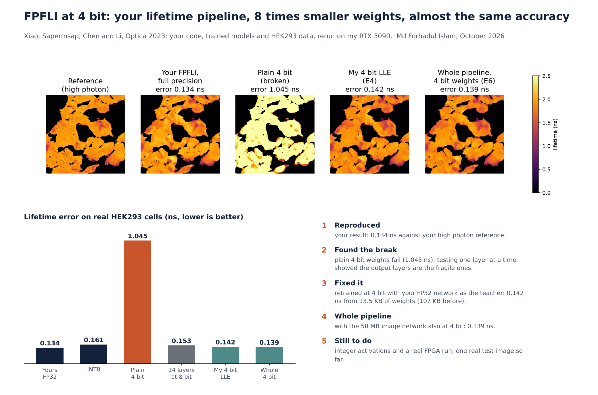
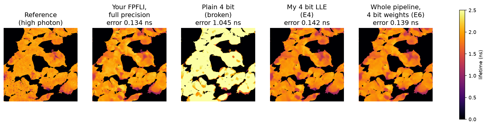

# Compressing a few photon fluorescence lifetime imaging pipeline from 32 bit to 4 bit weights while keeping near full precision accuracy

**Author:** Md Forhadul Islam

This repository holds four experiments on **FPFLI** (Few Photon Fluorescence Lifetime Imaging; Xiao, Sapermsap, Chen and Li, *Optica* 10(7), 944 to 951, 2023). FPFLI uses two neural networks to build a sharp fluorescence lifetime image from only about 10 photons per pixel.

The question behind the work is simple: **can this pipeline be made small enough for low power hardware such as an FPGA, without losing accuracy?** I reproduced the published pipeline, found exactly where 4 bit weights break it, and then retrained both networks so the whole pipeline runs with 4 bit weights.



## Headline result

| Pipeline (on real HEK293 cells, about 10.2 photons per pixel) | Lifetime error (MAE) | Weight memory |
|---|---|---|
| Published FPFLI, 32 bit floating point | 0.134 ns | LLE 106.5 KB, NIII 58.2 MB |
| Plain rounding of the LLE to 4 bit (no retraining) | 1.045 ns (broken) | LLE 13.3 KB |
| **My whole pipeline, both networks at 4 bit** | **0.139 ns** | **LLE 13.5 KB, NIII about 7.3 MB** |

The weights shrink about 8 times, and the error stays within 0.005 ns of full precision.



## The two networks in FPFLI

| Network | Job | Size at 32 bit |
|---|---|---|
| **LLE** (Local Lifetime Estimator, a 1D ConvMixer called tauNet) | Reads the photon arrival histogram of each 8 by 8 block of pixels and predicts one lifetime per block | 27,272 conv weights (28,865 parameters), 106.5 KB |
| **NIII** (Neural Implicit Image Interpolation, two RDN encoders and an MLP decoder) | Turns the blocky lifetime map into a sharp full resolution map, guided by the intensity image | 14,553,600 weights, 58.2 MB |

## The four experiments

The experiments run in order, and each one answers the question raised by the one before.

| | Folder | Question | What I found |
|---|---|---|---|
| **E2** | [`E2_reproduce_fpfli_and_find_the_4bit_break`](E2_reproduce_fpfli_and_find_the_4bit_break) | Can I reproduce FPFLI, and what happens if the LLE weights are simply rounded? | Reproduced 0.134 ns on HEK293 and 0.161 ns on six synthetic images. 8 bit costs a little (0.161 ns on HEK293). Plain 4 bit breaks the network (1.045 ns) and the whole map reads too long. |
| **E3** | [`E3_layer_sensitivity_photon_limit_and_uncertainty`](E3_layer_sensitivity_photon_limit_and_uncertainty) | Which layers break at 4 bit? How few photons is too few? Can FPFLI show where it is unsure? | The damage sits at the output end (`ponitconv1` 0.607 ns, `ponitconv3` 0.390 ns). Keeping sensitive layers at 8 bit needed 14 of 21 layers (25.1 KB), barely smaller than plain 8 bit, so retraining was needed. FPFLI beats the centre of mass method at normal light; near 1 photon per pixel they become close. |
| **E4** | [`E4_4bit_lifetime_estimator_with_qat_and_distillation`](E4_4bit_lifetime_estimator_with_qat_and_distillation) | Can retraining make a 4 bit LLE as good as the 32 bit one? | Yes. Quantisation aware training (v1, 0.185 ns), then distillation from the 32 bit teacher with matched training data (V2, 0.159 ns), learned scales (V3, 0.150 ns) and four tiny layers at 8 bit (V4, **0.142 ns from 13.5 KB**). |
| **E6** | [`E6_4bit_image_network_and_whole_pipeline`](E6_4bit_image_network_and_whole_pipeline) | Can the 58.2 MB NIII go to 4 bit, and does the whole pipeline still work? | Plain 4 bit NIII hurts moderately (0.157 ns). Distillation on practice images from a different SPAD camera fully recovers it (0.129 to 0.132 ns). **Whole pipeline at 4 bit: 0.139 ns on HEK293.** |

### Full results

| Model | Synthetic mean MAE | HEK293 MAE |
|---|---|---|
| LLE 32 bit (published) | 0.161 ns | 0.134 ns |
| LLE 8 bit, plain rounding | 0.165 ns | 0.161 ns |
| LLE 4 bit, plain rounding | 1.472 ns | 1.045 ns |
| LLE 4 bit, mixed precision (E3, 14 layers at 8 bit) | 0.155 ns | 0.153 ns |
| LLE 4 bit, QAT v1 | 0.259 ns | 0.185 ns |
| LLE 4 bit, V2 (plus distillation and matched data) | 0.165 ns | 0.159 ns |
| LLE 4 bit, V3 (plus learned scales) | 0.167 ns | 0.150 ns |
| LLE 4 bit, V4 (plus four tiny layers at 8 bit) | 0.167 ns | 0.142 ns |
| NIII 8 bit, plain rounding | 0.161 ns | 0.134 ns |
| NIII 4 bit, plain rounding | 0.294 ns | 0.157 ns |
| NIII 4 bit, distillation | 0.162 ns | 0.129 ns |
| NIII 4 bit, distillation and 3 layers at 8 bit | 0.158 ns | 0.129 ns |
| NIII 4 bit, distillation, learned scales and 3 layers at 8 bit | 0.157 ns | 0.132 ns |
| **Whole pipeline: V4 LLE plus best 4 bit NIII** | **0.162 ns** | **0.139 ns** |

Every number above is recomputed from the saved models in one deterministic run (E6 Part 3, `my_saved_model_check/saved_model_check.json`).

## Methods in brief

* **Quantisation:** per output channel, symmetric, weights only. At 4 bit each channel uses 15 levels (minus 7 to plus 7) with one scale per channel.
* **Quantisation aware training (QAT):** weights are rounded in the forward pass, and gradients pass through the rounding with the straight through estimator, `w + (q - w).detach()`.
* **Distillation:** the 4 bit student copies the 32 bit teacher. In E4 the loss is smooth L1 to the true lifetime plus smooth L1 to the teacher. In E6 it is L1 to the teacher only, on practice images, so Dr Li's test images are never used for training.
* **Learned step size quantisation (LSQ):** the scale of each channel is trained as well.
* **Mixed precision:** a few tiny or sensitive layers stay at 8 bit (392 weights in the LLE, 2,560 in the NIII).
* **BatchNorm recalibration** after training (E4 V2 to V4).

## Honest limitations

* **Weights only.** Activations are still 32 bit, so this is not yet an integer pipeline.
* **Simulated in PyTorch** (fake quantisation). It shows the accuracy effect, not speed or power. Nothing here has run on an FPGA yet.
* **Small test set:** one real image with a reference (HEK293) and six synthetic images, with one training seed per version. Small differences (for example V3 against V4) may be noise.
* **Versions were compared on the test images,** and the HEK293 IRF stored in the test file was used to build training decays for the 1 to 3 ns LLE.
* **Size figures** count conv and linear weights. Counting biases, BatchNorm and per channel scales, the 4 bit LLE is about 26 KB.

## Next steps

1. 8 bit activations with the same QAT and distillation method, so the whole pipeline becomes integer.
2. Run the 13.5 KB LLE on an FPGA and measure latency, power and accuracy on the board.
3. Apply the same method to blood flow estimation from diffuse correlation spectroscopy (DCS), where a small network also turns a photon signal into one number.

## How to run

The notebooks use Dr Li's released FPFLI code, trained models and sample data, which are **not copied here**. Download them from the original sources:

| What | Source | Put it in |
|---|---|---|
| FPFLI code, pretrained models and sample data (synthetic images, HEK293 cells, microspheres) | https://github.com/Dooongx/FPFLI (contents of its `Evaluation` folder) | `04_Shared_Code_and_Data/Dr_Li_FPFLI_code/` |
| Glasgow megapixel SPAD FLIM data, CC BY 4.0 (E6 retraining only) | https://doi.org/10.5525/gla.researchdata.1012 | `04_Shared_Code_and_Data/Datasets/SPAD_FLIM_Glasgow_Zickus2020/` |

Each folder has a `SOURCE.md` with step by step setup ([FPFLI](04_Shared_Code_and_Data/Dr_Li_FPFLI_code/SOURCE.md), [Glasgow data](04_Shared_Code_and_Data/Datasets/SPAD_FLIM_Glasgow_Zickus2020/SOURCE.md)).

```
04_Shared_Code_and_Data/
    Dr_Li_FPFLI_code/      (his FPFLI release: .py files, model_parameters/, sample_data/)
    Datasets/SPAD_FLIM_Glasgow_Zickus2020/   (only needed for E6 training)
E2_.../  E3_.../  E4_.../  E6_.../
```

1. Install Python 3.10 or newer, PyTorch, NumPy, SciPy, Matplotlib, Pillow, mat73 and Jupyter.
2. Open any notebook and run all cells. Each notebook climbs up the folders until it finds `04_Shared_Code_and_Data`, so no paths need editing.
3. E4 and E6 have a `RETRAIN` switch in the first cell. `False` (the default) loads the 4 bit models already trained and only scores them. `True` trains them again (about 35 minutes for E4 and about 2 hours for E6 on an RTX 3090) and saves the new models into `Dr_Li_FPFLI_code/model_parameters/`.

The `.py` files next to each notebook are the original standalone scripts that the notebooks were built from. They expect to be run from inside the FPFLI code folder.

All results in this repository were produced on an NVIDIA GeForce RTX 3090 in October 2026.

## Acknowledgements and references

* D. Xiao, N. Sapermsap, Y. Chen and D. D. U. Li, "Deep learning enhanced fast fluorescence lifetime imaging with a few photons", *Optica* 10(7), 944 to 951 (2023). [Strathprints](https://strathprints.strath.ac.uk/85874), [bioRxiv](https://www.biorxiv.org/content/10.1101/2023.04.06.534322v1), code at [github.com/Dooongx/FPFLI](https://github.com/Dooongx/FPFLI). The FPFLI code, pretrained models and sample data belong to the original authors.
* V. Zickus et al., "Fluorescence lifetime imaging with a megapixel SPAD camera and neural network lifetime estimation", *Scientific Reports* 10 (2020), [doi:10.1038/s41598-020-77737-0](https://doi.org/10.1038/s41598-020-77737-0). Data: [doi:10.5525/gla.researchdata.1012](https://doi.org/10.5525/gla.researchdata.1012), CC BY 4.0. Used only to make practice images for distillation in E6.
* S. K. Esser et al., "Learned step size quantization", ICLR 2020.
* Y. Bengio, N. Léonard and A. Courville, "Estimating or propagating gradients through stochastic neurons for conditional computation", arXiv 1308.3432 (2013).
* G. Hinton, O. Vinyals and J. Dean, "Distilling the knowledge in a neural network", arXiv 1503.02531 (2015).

## Contact

Md Forhadul Islam, forhadreza1596@gmail.com
